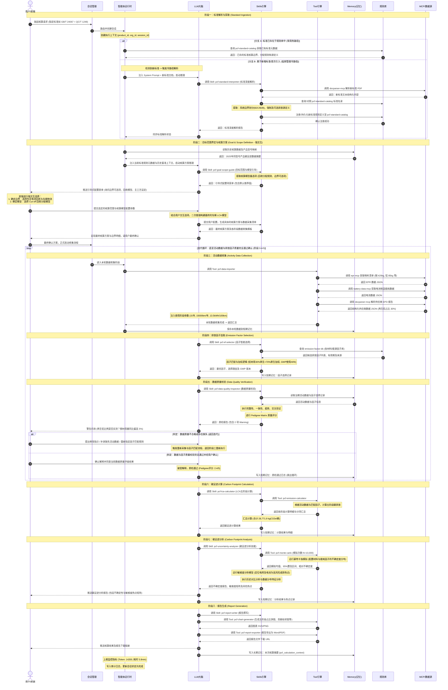

# 产品碳足迹智能体 — 详细模块交互说明文档

本说明文档详细解析了**产品碳足迹智能体（PCF Agent）**的模块交互时序，涵盖了智能体从**标准解析**、**多源数据采集**到**碳足迹计算**与**报告生成**的全流程。 

本系统专门针对电动车辆产品，结合 **GB/T 24067-2024**（产品碳足迹要求和指南）和 **QC/T 1248-2025**（汽车生命周期碳排放核算标准）的要求开展交互与计算。

---

## 1. 智能体组件与外部数据源定义

智能体架构采用模块化设计，分为智能体核心引擎、规则库与外部数据集成层（MCP）。

### 1.1 核心组件 (Core Components)

- **用户/前端 (User/Frontend)**：发起核算请求、配置产品参数、接收数据异常警告进行人机协同决策，并最终下载核算报告。
- **会话管理 (Session Management)**：负责维护计算上下文的状态及会话生命周期。
- **智能体运行时 (Agent Runtime)**：负责装载全局配置（YAML），监控智能体任务流转，并记录审计日志。
- **LLM大脑 (LLM Brain)**：基于推理引擎解析输入，调度不同的 Skill 与 Tool 协同工作。
- **短期记忆 (Short-term Memory)**：临时存储当前会话的活动数据、质检记录、核算结果及因子记录，随会话销毁。
- **长期记忆 (Long-term Memory)**：持久化存储每次核算的摘要信息（`pcf_calculation_context`），用于未来的同比分析与基准加载。

### 1.2 Skills 引擎 (Skills Engine)

- `pcf-standard-interpreter`：【标准解析技能】。仅在检测到新增/未知标准时启用，对标准文本进行结构化提取，分析生命周期边界定义、强制与可选排放源要求，并将其注册至规则库。
- `pcf-goal-scope-guide`：【强交互目标范围引导技能】。基于已解析的标准，向用户推送定制化的“引导配置问卷”，支持核算范围边界微调、分配模型设定及主要参数预配置，实现人机共建核算模型。
- `pcf-data-quality-inspector`：【数据质量检验技能】。对活动数据与匹配的排放因子进行完整性、一致性、趋势对比、交叉验证等多维度质检，并开展 Pedigree Matrix 质量评分。
- `pcf-ef-selector`：【排放因子智能选择技能】。根据活动数据与物料属性，实现原生/再生比例加权以及多因子源库的最优匹配。
- `pcf-lca-calculator`：【LCA 计算框架管理技能】。调度公式开展 LCA 五阶段碳排放核算。
- `pcf-uncertainty-analyzer`：【碳足迹分析技能】。运行统计与敏感度模型，对计算结果开展偏差分析、不确定度量化与碳减排风险热点评估。
- `pcf-report-writer`：符合标准的碳足迹报告自动撰写技能。

### 1.3 Tool 引擎 (Tool Engine)

- `pcf-data-importer`：多源数据并行导入工具。
- `pcf-emission-calculator`：各阶段碳排放公式计算执行器。
- `pcf-monte-carlo`：蒙特卡洛随机模拟器。
- `pcf-chart-generator`：可视化图表（饼图、柱状图、矩阵图）生成器。
- `pcf-report-exporter`：报告文件导出器（Word/PDF）。
- `pcf-unit-converter`：单位转换工具。

### 1.4 外部系统与数据源 (MCP & Rules)

- **MCP 数据接入层**：
  - `epr-mcp`：对接企业 ERP 提取车辆 BOM 物料清单。
  - `ecoinvent-db`：提供全球 LCA 默认排放因子。
  - `battery-data-mcp`：提供详细的动力电池电芯与组装能耗数据。
  - `docparser-mcp`：解析 PDF 格式的供应商 EPD（环保产品声明）报告。
- **规则与参数库 (Rules)**：
  - `pcf-standard-catalog`：国家与行业标准规范目录（含已注册解析的标准元数据规则）。
  - `emission-factor-db`：本企业首选排放因子与本地因子库。
  - `pedigree-matrix-db`：Pedigree 数据质量评分规则。
  - `pcf-formula-repo`：LCA 计算公式库。
  - `gwp-factor-db`：全球变暖潜势系数库（IPCC 各版本，如 AR6）。

---

## 2. 模块交互时序图 (Mermaid)

优化后的时序图在**阶段三至阶段五**增加了 **loop 内部迭代循环**，直观展示了数据与因子质量校验不通过时自动流转回溯的闭环机制。

---

## 3. 八大阶段交互细节与数据流说明

### 阶段一：标准解析与获取

1. **核算请求**：用户指定适用标准（如 GB/T 24067 + QC/T 1248）发起请求。
2. **分支判断**：
   - **已注册标准（热路径）**：直接从标准规则库 `pcf-standard-catalog` 中读取固化的边界、排放源分类和计算逻辑，跳过解析器调用。
   - **未注册/新标准（冷路径）**：检测到新规时，启动 `pcf-standard-interpreter` 技能并调用 `docparser-mcp` 深度解析标准 PDF。
3. **元数据归档**：将新标准解析出的结构化元数据（功能单位、边界划分限制、大宗物料强监管指示等）写入 `pcf-standard-catalog` 进行持久化注册，以便后续的核算任务直接引用。

### 阶段二：目标范围界定与核算方案 (强交互引导)

为了确保核算边界和分配模型符合真实产品及合规审计要求，系统在阶段二执行以下强交互流程：

1. **获取配置参考**：读取上期历史碳足迹基准。
2. **推送引导式表单**：智能体通过前端交互向用户呈现包含默认推荐的交互配置界面，提供以下决定性配置的交互：
   - **系统边界微调**：是否包含下游物流环节？是否计算报废后的零部件回收利用额度？
   - **核算模型选择**：选择分配规则模型（物理分配法、经济分配法，或报废回收的 Cut-off 回收模型、50/50 模型）。
   - **生命周期关键设定**：电动车寿命年限、百公里推荐电耗值微调等。
3. **提交与二次构建**：用户确认或微调后提交表单。LLM 大脑重新结合所选规则，自动映射并确定最终计算模型与“五阶段边界定义”。
4. **最终确认方案**：智能体向用户渲染最终的核算范围模型与所涉及的活动数据采集需求清单，用户进行最终的一键确认后，系统正式触发数据收集。

### 🔄 阶段 3-4-5 数据与因子质量闭环循环 (重要业务闭环)

在此迭代闭环中，系统对活动数据及排放因子的匹配进行反复修正校验，直到数据品质达到合规审计标准：

- **阶段三：活动数据收集**：智能体并行收集 BOM 数据 (EPR)、供应商环保声明 (DocParser 解析 EPD 报告获得铝材 30% 再生比例) 并录入使用阶段工艺常数。
- **阶段四：排放因子选取**：智能体调用 `pcf-ef-selector`，自动匹配最优候选因子（如加权铝因子等），并配置 IPCC AR6 (100年) 作为全局 GWP 因子。
- **阶段五：数据质量校验**：
  1. 系统运行完整性、一致性检查，计算各项数据的 Pedigree 质量评分。
  2. 若系统抛出质量警告（如“钢材用量同比偏高 5%”，“再生铝实测比例需佐证”），用户在前台可以选择“重新补录缺失的活动数据”或“在第四阶段重新指派因子匹配逻辑”，此时系统将**回溯执行阶段三与阶段四**，更新短期记忆数据集，开始新一轮校验。
  3. 若用户对警告进行了解释澄清（“增重系因为底盘加固，再生铝来源供应商 EPD 文件证明”），同意并最终确认，数据质量校验正式通过。系统**退出数据迭代循环**，固化 Pedigree 评分与因子匹配记录，正式流转至碳排放计算。

---

### 阶段六：碳足迹计算

系统调用 `pcf-emission-calculator` 工具进行生命周期五个阶段的详细计算：

1. **材料生产阶段**：
   - 钢材：$420\text{ kg} \times (2.1 \times 70\% + 0.5 \times 30\%)/1000 = 680.4\text{ kgCO₂e}$ (此处按再生钢修正)
   - 原生铝：$85\text{ kg} \times 70\% \times 8.2 = 487.9\text{ kgCO₂e}$
   - 再生铝：$85\text{ kg} \times 30\% \times 0.5 = 12.8\text{ kgCO₂e}$
   - 塑料：$120\text{ kg} \times 3.4 = 408.0\text{ kgCO₂e}$
   - *材料阶段小计*：$1,694.1\text{ kgCO₂e}$
2. **零部件与整车制造**：
   - 电池组装（实测）：$10,600\text{ kgCO₂e}$
   - 电机制造：$35\text{ kg} \times 12.8 = 448\text{ kgCO₂e}$
   - 装配能耗：$320\text{ kWh} \times 0.581 = 185.9\text{ kgCO₂e}$
   - *制造阶段小计*：$11,233.9\text{ kgCO₂e}$
3. **使用阶段**：
   - 总充电电量：$15\text{年} \times 15,000\text{ km/年} \times (13.5\text{ kWh}/100\text{km}) / 92\% = 32,908\text{ kWh}$
   - 电网排放：$32,908\text{ kWh} \times 0.581\text{ tCO₂/MWh} = 19,121.8\text{ kgCO₂e}$
4. **报废回收抵消**：
   - 钢、铝、电池回收抵消排放共计：$-3,277.9\text{ kgCO₂e}$
5. **核算总计**：**$28,771.9\text{ kgCO₂e/辆}$**。

---

### 阶段七：碳足迹分析

智能体调用 `pcf-uncertainty-analyzer` 对核算结果进行多维度统计与决策风险分析：

1. **数据分布分析**：对比历史数据，输出本次碳足迹分布的偏态与趋势特征。
2. **不确定度分析 (N=10,000)**：为各因子配置正态或三角分布进行蒙特卡洛模拟。得出均值 $28,771.9\text{ kgCO₂e}$，95%置信区间为 `[25,420, 32,150]`，相对不确定度为 `±12.1%`。
3. **敏感度分析（风险热点）**：定量计算各输入因子对总计算结果的偏差贡献率（电网因子变动 10% 导致结果变动 6.8%），锁定“华东区域电网因子”与“电池制造数据”为关键风险热点。

---

### 阶段八：报告生成

1. **可视化图表生成**：生成核算明细饼图、贡献度柱状图、不确定性区间图、风险热点图等。
2. **报告打包与下载**：调用 Word/PDF 导出工具生成正式的产品碳足迹核算报告（符合 GB/T 24067 和 QC/T 1248 标准），并生成下载链接。
3. **长期记忆写入**：保存当前车型与计算年份的摘要至 `Long-term Memory`（数据结构包含：`product_id`、`total: 28,771.9` 等），供下期对比。

---

## 4. 智能体交互设计亮点

1. **阶段3-4-5 数据与因子质量闭环循环**：**【核心优化】** 系统为数据收集、因子指派及数据质量控制（完整性、一致性、合理性及 Pedigree 评分）设计了独立的交互循环。在质检发现缺陷时支持回溯修正，直到不确定性和偏差被压低至符合合规审计限值、且经用户完全确认并固化评分后，才被允许跳出循环进入计算阶段，彻底规避了输入缺陷污染计算阶段（GIGO）。
2. **更严谨合理的阶段设计**：数据采集（阶段三）与因子选择（阶段四）在计算前全部准备就绪。数据质量校验（阶段五）作为独立的质量关口置于计算前，实现了对“活动数据与因子匹配度”的双重把关，确保只有符合完整性与一致性的干净数据才流入计算阶段（阶段六），全面杜绝了数据质量隐患。
3. **独立的碳足迹分析深度（阶段七）**：系统在计算完成后，专门开辟独立的“碳足迹分析”阶段，集成了数据趋势分析、蒙特卡洛模拟与敏感度热点矩阵，将单纯的“计算结果”升华为“减排洞察与决策建议”。
4. **热冷路径分离设计（分支标准解析）**：根据标准“静态低频更新，日常核算高频引用”的特征，引入双轨路由设计。日常核算直接走“热路径”从规则库拉取已有规则定义；仅在新标准发布或首次载入时，才激活“冷路径”，启动 `pcf-standard-interpreter` 技能并执行深度解析，在将标准元数据注册归档到规则库后，未来的核算即可实现瞬时加载，避免了不必要的算力和 Token 浪费。
5. **目标与模型的人机协同强交互设计**：在阶段二“目标范围界定与核算方案”中，系统完全摒弃了单一的“系统直接扔出方案、用户被动确认”的简单逻辑，引入了深度的人机协同。智能体通过 Skills 引擎生成“引导配置菜单”，提供范围微调和多种分配回收模型（如 Cut-off 还是 50/50 模型），由用户进行针对性选择。智能体在此反馈上执行二次模型推理，生成真正切合产品特征与企业审计目标的“定制化核算模型”，极大保障了碳足迹计算方案的灵活性 and 符合度。
