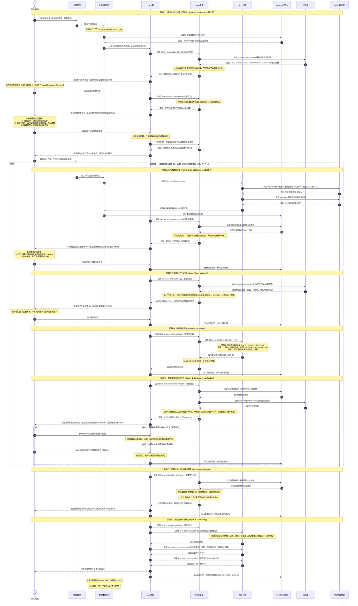

# 组织碳核算智能体 — 详细模块交互说明文档

本说明文档详细解析了**组织碳核算智能体（OCA Agent）**的模块交互时序，涵盖了智能体从**标准与边界选择**、**多源数据采集**到**碳排放计算**与**合规报告生成**的全流程。

本系统专门针对企业和园区组织层面碳排放核算，结合 **ISO 14064-1**（组织层面温室气体量化与报告）、**GHG Protocol**（温室气体核算体系）及 **GB/T 32150**（工业企业温室气体排放核算通用指南）等标准的要求开展交互与计算。

---

## 1. 智能体组件与外部数据源定义

智能体架构采用模块化设计，分为智能体核心引擎、规则库与外部数据集成层（MCP）。

### 1.1 核心组件 (Core Components)

- **用户/前端 (User/Frontend)**：发起核算请求、配置组织与范围边界、接收数据异常警告进行人机协同决策，并最终下载核算报告。
- **会话管理 (Session Management)**：负责维护计算上下文的状态及会话生命周期。
- **智能体运行时 (Agent Runtime)**：负责装载全局配置（YAML），监控智能体任务流转，并记录审计日志。
- **LLM大脑 (LLM Brain)**：基于推理引擎解析输入，调度不同的 Skill 与 Tool 协同工作。
- **短期记忆 (Short-term Memory)**：临时存储当前会话的活动数据、排放因子记录、核算结果及质检记录，随会话销毁。
- **长期记忆 (Long-term Memory)**：持久化存储每次核算的摘要信息（`oca_calculation_context`），用于未来的同比分析与基准加载。

### 1.2 Skills 引擎 (Skills Engine)

- `oca-standard-selector`：【标准选择与推荐技能】。根据组织行业属性与核算场景，从规则库中推荐适用的核算标准组合（如 ISO 14064-1 + GHG Protocol Corporate Standard），并向用户推送推荐理由与差异对比。
- `oca-boundary-guide`：【核算边界引导技能】。通过引导式问卷帮助用户确定组织边界（法人边界/运营控制边界/股权比例边界）和范围边界（范围1必选、范围2必选、范围3可选类别选择），实现人机共建核算模型。
- `oca-data-collector`：【AI对话数据采集技能】。自动识别活动数据缺口，通过AI对话逐项引导用户补充缺失数据，AI预填建议值供确认修正，替代传统表格式填报。
- `oca-ef-matcher`：【排放因子智能匹配技能】。根据活动数据类型与地域属性，自动从因子库中匹配最优排放因子，支持地区因子优先、行业因子次选、国际因子兜底的三级匹配策略。
- `oca-emission-calculator`：【碳排放计算技能】。按范围1（直接排放）、范围2（间接排放-外购能源）、范围3（其他间接排放）分类执行碳排放核算，支持多维度聚合（园区级/企业级/车间级）。
- `oca-compliance-inspector`：【合规校验技能】。对照核算标准自动执行合规性校验（数据完整性/一致性/阈值/逻辑），校验异常生成卡片推送对话区引导修正。
- `oca-uncertainty-analyzer`：【不确定度分析技能】。对活动数据和排放因子进行不确定度评估，识别减排热点与关键风险因子。
- `oca-report-generator`：【核算报告生成技能】。自动生成符合标准的组织碳排放核算报告，支持范围1-3七级溯源。

### 1.3 Tool 引擎 (Tool Engine)

- `oca-data-importer`：多源数据并行导入工具（对接 ERP/EMS/能耗监测等系统）。
- `oca-emission-calculator-tool`：范围1/2/3碳排放公式计算执行器。
- `oca-unit-converter`：单位换算工具（支持能耗单位、排放量单位转换）。
- `oca-traceability-builder`：七级溯源链构建工具（从总结果→范围→类别→排放源→活动数据→排放因子→原始凭证逐级下钻）。
- `oca-chart-generator`：可视化图表（范围占比饼图、趋势柱状图、溯源链图、减排热点图）生成器。
- `oca-report-exporter`：报告文件导出器（Word/PDF/Excel）。

### 1.4 外部系统与数据源 (MCP & Rules)

- **MCP 数据接入层**：
  - `erp-mcp`：对接企业 ERP 提取能源消耗数据（电/气/油/煤等）。
  - `ems-mcp`：对接能源管理系统获取实时能耗监测数据。
  - `emission-factor-mcp`：国家/地区/行业排放因子数据库。
  - `docparser-mcp`：解析供应商碳排放报告与 EPD 声明文件。
- **规则与参数库 (Rules)**：
  - `oca-standard-catalog`：核算标准规范目录（ISO 14064-1, GHG Protocol, GB/T 32150 等含已注册解析的标准元数据规则）。
  - `emission-factor-db`：企业首选排放因子与本地因子库（国家因子优先→地区因子→行业因子→国际因子）。
  - `oca-compliance-rules`：合规校验规则库（完整性/一致性/阈值/逻辑规则）。
  - `oca-formula-repo`：核算公式库（范围1/2/3计算公式与汇总规则）。
  - `gwp-factor-db`：全球变暖潜势系数库（IPCC 各版本，如 AR6）。
  - `organization-boundary-rules`：组织边界规则（法人边界/运营控制边界/股权比例合并规则）。

---

## 2. 模块交互时序图 (Mermaid)

优化后的时序图在**阶段三至阶段五**增加了 **loop 内部迭代循环**，直观展示了活动数据采集、排放因子匹配与合规校验不通过时自动流转回溯的闭环机制。

---

## 3. 七大阶段交互细节与数据流说明

### 阶段一：标准选择与核算方案确定（强交互引导）

为了确保核算边界和范围设定符合真实组织属性及合规审计要求，系统在阶段一执行以下强交互流程：

1. **获取历史基准**：读取上期历史碳排放基准数据，作为对比参考。
2. **标准推荐**：智能体根据组织行业属性与核算场景，从 `oca-standard-catalog` 中筛选适用标准组合，推送推荐卡片包含推荐理由与适用场景说明。
3. **边界配置引导**：
   - **组织边界微调**：选择法人边界（股权比例合并）或运营控制边界。
   - **范围边界选择**：范围1（直接排放）和范围2（外购能源间接排放）为必选，范围3（其他间接排放）提供15类可选类别供勾选。
   - **核算维度设定**：选择园区级、企业级或车间级核算维度。
4. **提交与二次构建**：用户确认配置后，LLM 大脑重新结合所选标准与边界规则，自动构建最终的核算方案与数据采集清单。
5. **最终确认方案**：智能体向用户渲染最终的核算范围模型与数据采集需求清单，用户一键确认后系统正式触发数据采集。

### 🔄 阶段 2-3-4-5 数据与合规质量闭环循环 (重要业务闭环)

在此迭代闭环中，系统对活动数据、排放因子匹配及合规性进行反复校验修正，直到数据品质达到合规审计标准：

- **阶段二：活动数据采集（AI对话引导）**：智能体自动从 ERP/EMS 系统获取基础能耗数据，AI 识别数据缺口后通过对话逐项引导用户补充。用户在对话中确认 AI 预填建议值或提供实际数据，替代传统表格式填报。
- **阶段三：排放因子匹配**：智能体调用 `oca-ef-matcher`，执行三级因子匹配策略（地区因子优先→行业因子次选→国际因子兜底），自动匹配最优排放因子，并向用户推送匹配结果卡片供确认。
- **阶段四：碳排放计算**：系统调用 `oca-emission-calculator-tool`，按范围1（燃料燃烧+工艺排放+逸散排放）、范围2（外购电力+外购蒸汽/热力）、范围3（上游运输+外购商品+员工通勤等）逐级计算汇总。
- **阶段五：数据质量与合规校验**：
  1. 系统运行完整性校验（各范围覆盖率）、一致性校验（同比/环比对比）、阈值校验与逻辑校验。
  2. 若系统抛出合规警告（如"电力消耗同比增幅 12%需说明原因"、"范围3覆盖率仅 75%低于建议80%"），用户在对话区可以选择"补充说明"或"修正数据"，此时系统将**回溯执行阶段二或阶段三**，更新短期记忆数据集，开始新一轮校验。
  3. 若用户对警告进行了合理说明与澄清，同意并最终确认，合规校验正式通过。系统**退出数据迭代循环**，固化核算结果与合规评级，正式流转至不确定度分析。

---

### 阶段六：不确定度分析与减排洞察

智能体调用 `oca-uncertainty-analyzer` 对核算结果进行多维度分析：

1. **数据不确定度评估**：对活动数据和排放因子分别评估不确定度等级，计算总不确定度区间。
2. **敏感度分析**：定量计算各输入因子对总排放量的偏差贡献率，识别关键驱动因子。
3. **减排热点识别**：基于敏感度分析与行业减排潜力数据，锁定关键减排热点（如"外购电力"与"天然气消耗"），推送减排建议。

---

### 阶段七：报告生成与溯源

1. **七级溯源链构建**：调用 `oca-traceability-builder` 构建从总结果→范围→类别→排放源→活动数据→排放因子→原始凭证的七级下钻溯源链，确保每项数据可追溯可验证。
2. **可视化图表生成**：生成范围占比饼图、趋势对比柱状图、减排热点矩阵图等。
3. **报告打包与下载**：调用 Word/PDF 导出工具生成正式的组织碳排放核算报告（符合 ISO 14064-1 和 GHG Protocol 标准），并生成下载链接。
4. **长期记忆写入**：保存当前组织与核算年度的摘要至 `Long-term Memory`（数据结构包含：`org_id`、`total: 18,254.3`、范围1/2/3分项等），供下期对比与ESG披露使用。

---

## 4. 智能体交互设计亮点

1. **AI对话驱动数据采集（核心创新）**：系统在阶段二采用 AI 对话引导而非传统表格式填报，智能体自动识别数据缺口并逐项推送补录卡片，AI 预填建议值供用户确认修正。这种交互模式让用户从"找数据→填表格"的被动模式升级为"智能体主动引导→对话确认"的主动模式，大幅提升数据采集效率与准确性。

2. **阶段2-3-4-5数据与合规质量闭环循环**：**【核心优化】** 系统为数据采集、因子匹配、碳排放计算与合规校验设计了独立的交互循环。在合规校验发现问题时支持回溯修正，直到合规性与数据质量完全通过并经用户确认后，才被允许跳出循环进入分析阶段，彻底规避了数据缺陷污染最终结果（GIGO）。

3. **三级排放因子匹配策略**：根据活动数据的地域属性自动执行"地区因子优先→行业因子次选→国际因子兜底"的三级匹配策略，确保因子匹配的地理精准性与合规性，同时为用户提供因子来源与选择理由的透明说明。

4. **多标准自适应规则引擎**：内置国际（ISO 14064-1/GHG Protocol）、国内（GB/T 32150）、地方三级核算标准，通过规则模块化、参数化设计，实现新政策、新规则的一键接入与自动更新，解决多标准、多维度核算的适配难题。

5. **核算边界的人机协同强交互设计**：在阶段一"标准选择与核算方案确定"中，系统通过 Skills 引擎生成"引导配置问卷"，提供组织边界选项（法人/运营控制）和范围边界选项（范围3的15类可选类别），由用户进行针对性选择。智能体在此基础上二次推理，生成真正切合组织属性与审计目标的"定制化核算方案"，极大保障了核算方案的灵活性与符合度。

6. **七级溯源体系**：从最终核算结果逐级下钻到原始凭证，确保每项碳排放数据可追溯、可验证、可审计，满足合规审计与ESG披露的双重要求。
